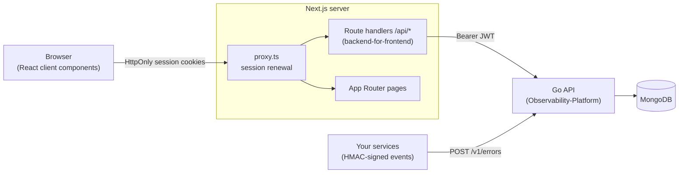

<div align="center">

# Tracewell

**Error monitoring and observability for teams — the web dashboard.**

Capture errors from any service, search and triage them across projects, and manage team access, API keys, and integrations from one place.

[](https://nextjs.org)
[](https://react.dev)
[](https://www.typescriptlang.org)
[](https://tailwindcss.com)
[](https://github.com/UmangSachdeva/Observability-Platform)

</div>

---

## Overview

Tracewell is a self-hostable error-tracking platform in the spirit of Sentry. Services report errors through a signed HTTP API; engineers use this dashboard to find, understand, and act on them.

This repository is the **Next.js frontend**. It talks to a separate [Go + MongoDB API](https://github.com/UmangSachdeva/Observability-Platform) through a backend-for-frontend layer, so credentials never reach the browser.

## Features

### Error triage
- **Server-side search** across message, service, environment, and stack trace, with multi-select filters for level, service, environment, project, time range, and custom attributes.
- **Sorting and cursor pagination** that stays stable while new events arrive, plus automatic refresh every 30 seconds.
- **Account-wide search (⌘K)**: a command palette that searches errors across every project, plus projects and pages, fully keyboard-driven.
- **Error detail pages** with a shareable URL for every event:
  - Stack traces parsed into frames for **JavaScript, Python, Go, Java/Kotlin, and .NET**, with your own code highlighted and library frames collapsed.
  - Occurrence analytics: times seen, first and last seen, an hourly or daily histogram, and breakdowns by environment and attribute (for example, which release or host is affected).
  - Attributes with one-click "filter by" links, precise timing including delivery delay, and the raw event JSON.

### Projects, API keys, and integration
- **Project-scoped API keys**: every key belongs to a project, and events are attributed automatically.
- **Secrets shown once and never displayed**: a new secret can only be copied, and only right after creation.
- **Guided integration**: a step-by-step setup page with copy-paste snippets for Node.js, Python, Go, and cURL, each with no dependencies, plus a one-click **signed test event** to verify the setup end to end.

### Teams and accounts
- **Invitations** by link or in-app: invitees accept or decline in a modal, and pending invitations are polled in the background and can be **snoozed**.
- **Member management** with roles, plus a safe "leave account" flow that blocks the last admin from leaving.
- **Multiple accounts and projects**, with a project switcher in the top bar.

### Sessions
- **Silent session renewal**: expired access tokens are exchanged for a new pair before a page or API route runs, so users stay signed in without interruption.
- Expired sessions redirect to sign-in and return the user to where they were.

## Architecture



- **Backend-for-frontend.** The browser only calls same-origin `/api/*` route handlers. They read the session from **HttpOnly, SameSite cookies**, attach the JWT, and forward the request to the Go API. Tokens are never exposed to client-side JavaScript.
- **Session renewal at the edge of the app.** [`proxy.ts`](proxy.ts) runs before dashboard pages, invite pages, and API routes. It renews tokens shortly before they expire, writes the rotated pair to cookies, and passes the new token to the current request so nothing fails mid-flight. If the API is briefly unreachable, the user is not signed out.
- **Signed ingestion.** Services send events with HMAC-SHA256 request signatures (access key, timestamp, and body hash), which the integration guide and test-event route implement.

## Engineering highlights

| Area | Decision |
|---|---|
| Security | Tokens stay in HttpOnly cookies behind a BFF; API secrets are never rendered; search parameters are allow-listed before being forwarded upstream. |
| Resilience | Background polling pauses when the tab is hidden; transient API failures keep the last good data instead of clearing the UI. |
| Data correctness | Keyset (cursor) pagination with automatic recovery from invalidated cursors; results for a previous project are never shown under the current one. |
| UX | Shareable, URL-driven filters; ⌘K palette; keyboard navigation; responsive layout down to small phones. |
| Developer experience | A guided integration page whose code snippets were verified against the server's signature check. |

## Tech stack

- **Framework:** Next.js 16 (App Router, Route Handlers, Proxy), React 19
- **Language:** TypeScript and modern JavaScript
- **Styling:** Tailwind CSS 4 and hand-written CSS with a dark design system
- **Backend:** Go and MongoDB ([Observability-Platform](https://github.com/UmangSachdeva/Observability-Platform))

## Getting started

**Prerequisites:** Node.js 20+ and a running instance of the [Go API](https://github.com/UmangSachdeva/Observability-Platform).

```bash
git clone https://github.com/UmangSachdeva/Observability-Platform-frontend.git
cd Observability-Platform-frontend
cp .env.example .env.local   # point OBSERVABILITY_API_URL at the Go API
npm install
npm run dev                  # http://localhost:3000
```

| Script | Description |
|---|---|
| `npm run dev` | Start the development server |
| `npm run build` | Create a production build |
| `npm start` | Serve the production build |
| `npm run lint` | Run ESLint |

### Configuration

| Variable | Required | Description |
|---|---|---|
| `OBSERVABILITY_API_URL` | Yes | Base URL of the Go API used by the server. Defaults to `http://localhost:8080`. |
| `OBSERVABILITY_INGEST_URL` | No | Public URL your services use to send events, shown in the integration guide. Defaults to `OBSERVABILITY_API_URL`. |

## Project structure

```
app/
├── api/                    # Backend-for-frontend route handlers (proxy to the Go API)
│   ├── auth/               # signup, login, logout
│   ├── errors/             # account-wide error search
│   ├── projects/[id]/      # project errors and single-event lookup
│   ├── keys/               # API key list/create and signed test events
│   └── invites/, account/  # invitations, membership, leave account
├── dashboard/              # Overview, Errors (+ detail pages), Integrate, API keys, settings
├── invite/[token]/         # Invitation landing page
└── login/, page.tsx        # Authentication
proxy.ts                    # Session renewal before pages and API routes
src/
├── components/dashboard/   # Dashboard UI: error search, detail page, ⌘K search, dialogs
└── lib/                    # Session cookies, token refresh, search proxy, stack-trace parser
```

## Related

- **API:** [UmangSachdeva/Observability-Platform](https://github.com/UmangSachdeva/Observability-Platform), the Go service that handles ingestion, search, authentication, accounts, and projects.

---

<div align="center">
Built by <a href="https://github.com/UmangSachdeva">Umang Sachdeva</a>
</div>
